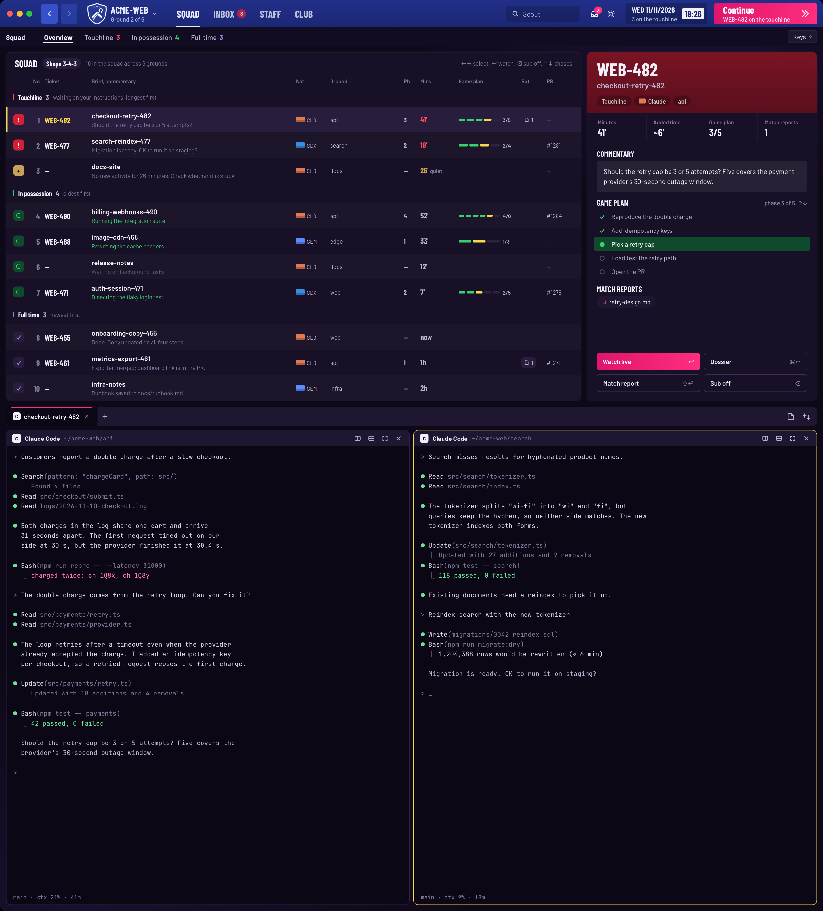
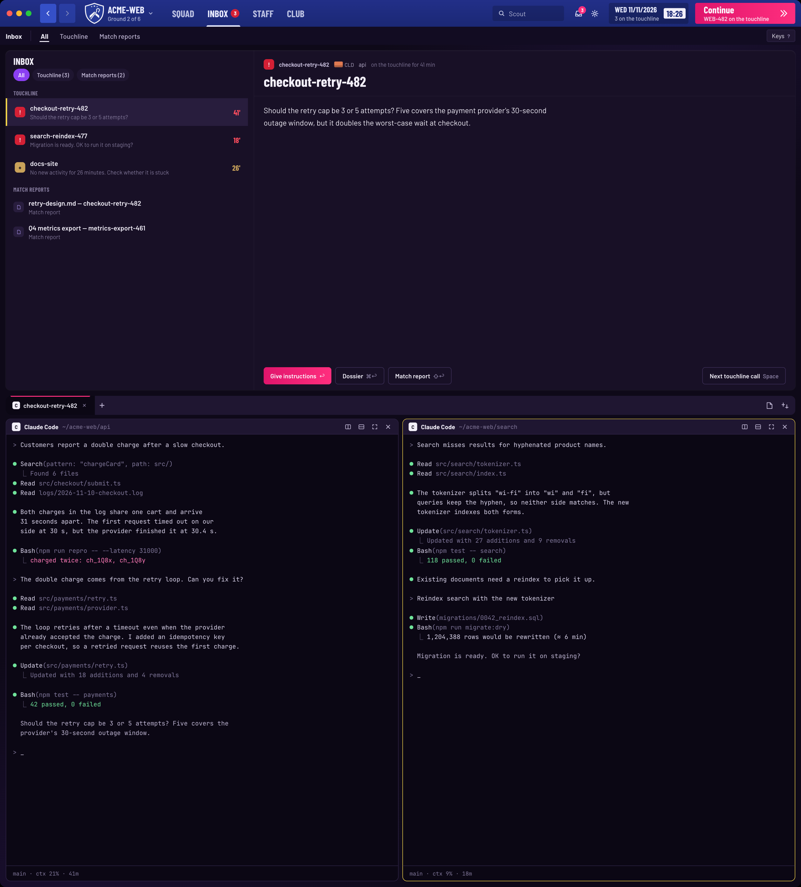
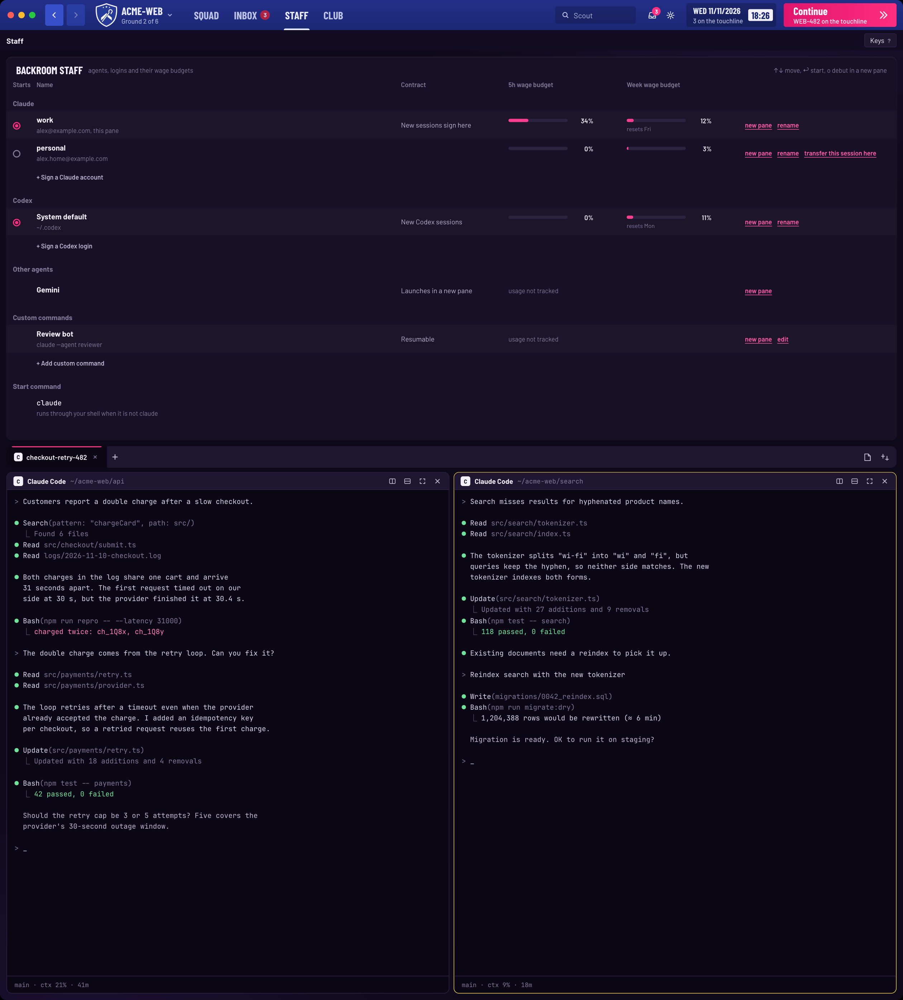
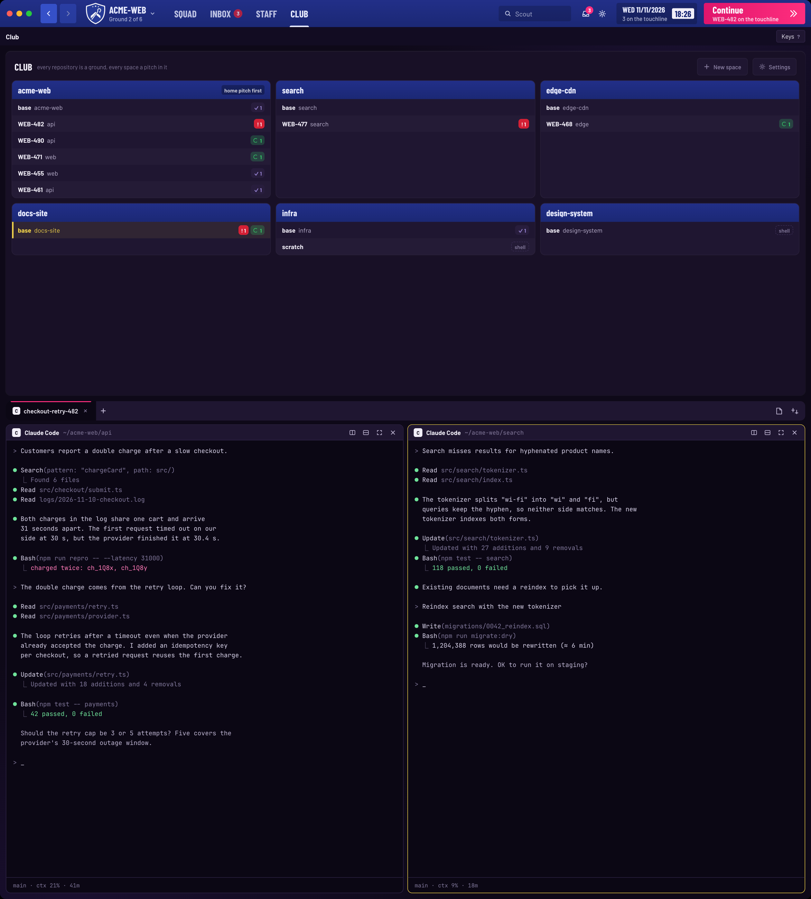

# FM27

A Football Manager 27-styled layout for [Herdr](https://herdr.dev). Claude Code, Codex and Gemini CLI sessions become a squad list: a match table with a player overview, an Inbox of touchline calls and match reports, a Staff screen of accounts and usage, and a Club screen of grounds and pitches. A chrome bar on top carries the screen menu, Scout search, match reports, the matchday clock and Continue; the live terminal always sits below the screens.

The data, grouping, actions and keys are forked from the author's own chiikawa-cards layout.



The screenshots use made-up sessions and terminals, rendered by `art/render.mjs` from `art/preview.html`, a sample-data copy of the window.

## Add it

Paste this into an agent running in Herdr:

```
Read ~/.config/herdr-app/AGENTS.md, then add this layout: https://github.com/lcalmsky/herdr-fm27
```

Or, from a checkout:

```sh
./tools/install.sh
```

The script copies `mods/fm-chrome`, `mods/fm-squad`, `mods/fm-staff`, `mods/fm-club`, `mods/fm-live` and `mods/fm-editor`, plus `layouts/fm27.json` and `themes/fm27.json`, into `${HERDR_APP_HOME:-$HOME/.config/herdr-app}`. It makes `cca`, `usage-tap.sh`, `hv`, `hv-open` and `scan.sh` executable, copies `shared/tokens.js` into each mod as `tokens.js`, merges `keys/fm27.json` into the person's `keys.json` (writing a `keys.json.bak-fm27-<timestamp>` copy first) and runs `herdr-app check` on each mod. Nothing is downloaded and no images are generated.

The merged section applies only while this layout shows:

```json
"layout:fm27": {
  "ctrl-alt-p": "fm-chrome.toggle",
  "ctrl-shift-a": { "command": "layout.select", "args": { "stack": "screens", "child": "staff" } },
  "cmd-=": "fm-chrome.font_in",
  "cmd-+": "fm-chrome.font_in",
  "cmd--": "fm-chrome.font_out",
  "cmd-0": "fm-chrome.font_reset",
  "cmd-[": "fm-chrome.back",
  "cmd-]": "fm-chrome.forward"
}
```

The top bar is the only copy of `fm-chrome` that listens for these keys, so each one is forwarded once to the squad table as an `fm.cmd`.

Before adding it, know what the mods run and read outside their folders:

- **`fm-chrome`** runs no programs and reads no files. It reads Herdr's space list, the layout tree and the other mods' `shared()` values, and writes the screen selection (`layout.select`) and shared values. No network calls.
- **`fm-squad`** runs `sh <appHome>/mods/fm-squad/scan.sh` every 3 s. It also reads `<appHome>/fm27.json` once at start for the Dossier URL bases and repo prefixes (see [Configure](#configure-optional)). The script runs `python3`, `ps` (process environments, and the process list for native Codex and Gemini sessions and `claude attach`) and `lsof` for each agent process's cwd. It reads Claude Code's session records and transcripts under `~/.claude` (or `$CLAUDE_CONFIG_DIR`) and each `~/.claude-accounts/*` that has a `sessions/` folder; native Codex rollouts under `~/.codex/sessions`; Gemini chats under `~/.gemini`; deadhd checklist state under `/tmp/deadhd-state` (or `$DEADHD_STATE_DIR`); page alerts under `~/.pulse/pages` (or `$PULSE_PAGES_DIR`); the handoff file a session's first prompt names; Maveyyo thread state under `~/.claude/state/maveyyo-bot`; and rolling-delivery goals under `~/.claude/state/rolling-delivery/active-programs.json`. It writes only its ledger and identity caches under `${TMPDIR:-/tmp}/herdr-pulse`, and it never opens `*.key` files. Opening a session runs `tmux` (`switch-client`, `select-window`, `select-pane`) or the Orca CLI at `/Applications/Orca.app/Contents/Resources/bin/orca` then `open -a Orca`, or splits a pane running `claude attach`; a report opens with `open` and its alert files are deleted with `rm -f`; Dossier links open in your browser (a local file with `open`); Show game plan runs `hc send`; the ⌘= / ⌘- / ⌘0 keys rewrite `font_size` in Herdr's `settings.json` under the app home. `fm-squad` makes no network calls.
- **`fm-staff`** runs `cca` (a `sh` script in its folder) with `--porcelain` every 30 s and when the focused pane changes; its actions run `cca --porcelain-add`, `--porcelain-add-codex`, `--porcelain-add-model`, `cca use`, `cca codex use` and `--porcelain-rename`. It also runs `sh -c cat` on `${XDG_STATE_HOME:-$HOME/.local/state}/herdr-tower/chiikawa-launch` and `models.json`, writes the Claude start command to `chiikawa-launch`, and starts panes with `sh -lc` running `claude`, that start command, a Codex agent or another installed agent. `cca` reads `~/.claude`, `~/.claude-accounts`, `~/.claude.json`, `~/.codex`, `~/.codex-accounts`, Codex's `auth.json` and rollouts, and Claude Code's session and usage files; it writes `current`, `codex-current`, `labels`, `usage/*.json` and `models.json` under `~/.local/state/herdr-tower`, and signing an account creates `~/.claude-accounts/<name>` or `~/.codex-accounts/<name>` with symlinks into `~/.claude` or `~/.codex`. **This is the only code here that reaches the network:** at most every 5 minutes, when `node` and macOS `security` are present, it reads each account's OAuth token from the keychain and `usage-api.mjs` fetches `https://api.anthropic.com/api/oauth/usage`; `codex-usage.mjs` only reads local rollout files. A custom command's `usage` line runs through `/bin/sh -c` with a 5 s timeout on each read. The optional `usage-tap.sh` status-line hook writes `${XDG_STATE_HOME:-$HOME/.local/state}/herdr-tower/usage/<account>.json`.
- **`fm-club`** runs `git -C <terminal cwd> rev-parse --path-format=absolute --git-common-dir --show-toplevel` for each distinct terminal cwd every 30 s. It reads no files outside its folder and reorders spaces with `space.move`; no network calls.
- **`fm-live`** runs no programs. It reads Herdr's spaces, tabs, panes and layout tree, opens the shipped `menu` and `new-menu` popups, and remembers each space's Files/Changes panel choice in localStorage `panels`. No network calls.
- **`fm-editor`** runs no programs. It reads and writes the file path `hv` passes it; `hv` itself runs `herdr-app ls` and `herdr-app do pane.split`, plus `/usr/bin/python3`. `hv-open` runs `open -a`, `open -t`, `awk` and `date`, reads `${XDG_STATE_HOME:-$HOME/.local/state}/herdr-tower/open-previous.tsv`, and appends the route to `open.log` there. No network calls.

`RECIPE.md` is the brief to build it from scratch.

## Configure (optional)

The Dossier's Jira and Slack rows and the repository prefixes `fm-squad` recognizes come from `<appHome>/fm27.json` (`${HERDR_APP_HOME:-$HOME/.config/herdr-app}/fm27.json`). Every key is optional; without the file the squad still runs, with no Jira or Slack row and no repository prefix.

```json
{
  "jiraBrowse": "https://acme.atlassian.net/browse/",
  "slackArchives": "https://acme.slack.com/archives/",
  "repos": ["shop"]
}
```

- `jiraBrowse` — the base a ticket key is appended to for the Dossier's **Jira ticket** row and its J key. Without it there is no row.
- `slackArchives` — the base a thread is appended to as `<channel>/p<timestamp>` for the **Slack thread** row and its S key. Without it there is no row.
- `repos` — the repository prefixes a session folder may start with (`shop-<rest>-<TICKET>`); the prefix is stripped from a row's ground. Without it no folder is read as a repository.

A missing or invalid file reads as if it were absent, and nothing appears in the notice bar.

## Screens

- **Squad** (the image at the top). The match table (left) and the selected session's player overview (right). The table groups sessions into *Touchline* (needs you), *In possession* (working) and *Full time* (done, four shown with "+N more at full time"); a stall joins the touchline as a *Stoppage*.
- **Inbox**. The touchline calls and match reports on the left, the picked session's or report's body on the right, and the action row underneath. Filter chips *All*, *Touchline (n)*, *Match reports (n)*; with no rows the body is the calm empty state: "Nothing on the touchline".

  

- **Staff**. The backroom: every Claude and Codex login, the custom commands and the Claude start command. The radio marks the login new sessions start under, the 5h and week windows read as wage budgets, and **Continue this session as** is *Transfer this session here*.

  

- **Club**. Every git repository is a ground and every space a pitch in it, one row per space with the crew's status pills. A click selects a space, a drag (or ⌥↑/⌥↓) reorders it inside its ground, a right-click opens Herdr's space menu, and the chrome's crest opens the same list as a dropdown.

  


Below the screens the **live** block is always there: the tabs bar and the active terminal. **Editor** panes are optional and come from `hv`.

## Keys

**The squad table** (when it holds the keyboard — click it, or press ctrl-alt-p):

| key | action |
|---|---|
| ← → | Select the previous / next row |
| ⌥← ⌥→ | First / last row |
| ↩ | Watch live (go to the session) |
| ⇧↩ | Match report |
| ⌘↩ | Dossier (same as right-click) |
| ⌫ | Sub off / rest (snooze a stall, dismiss a done session) |
| ⌘Z | Undo the last notice |
| Space | Continue — the longest touchline call |
| ⇧Space | Next full time |
| ↑ ↓ | Phases — open, scroll and close the selected session's game plan |
| Tab | Next match report |
| Esc | Back — clears the search, then deselects, then hands the keyboard back to the terminal |
| ? | The key legend |
| letters | Scout search; ⌘⌫ clears it, ⌥⌫ deletes its last word |

**The Inbox** is driven by clicks: a row selects, the filter chips narrow the list, and the body's buttons name the same action the table's key runs (↩ Watch live, ⌘↩ Dossier, ⇧↩ Match report, ⌫ Sub off, Space Continue).

**The Dossier popup** — one letter runs an entry:

| key | action |
|---|---|
| J | Jira ticket |
| P | Pull request |
| S | Slack thread |
| G | Report page |
| C | Show game plan (asks the session for its checklist) |
| ↑ ↓ | Move the highlight; ↩ runs it; Esc closes |

**The Club screen** (when it holds the keyboard): ↑↓ move (wraps), ↩ or Space opens the space, ⌥↑ ⌥↓ move it one row inside its ground.

**The Staff screen** (when it holds the keyboard): ↑↓ move, ↩ starts/uses the row, `o` debuts it in a new pane, Esc hands the keyboard back to the terminal.

**The live tabs** (when the bar has the keyboard): ←→ move along the tabs, ↩ or Space selects. With the mouse, the wheel switches tabs, a double-click renames, a drag reorders, and the right-click menu opens the tab menu.

**The layout keys** (from `layout:fm27` above): ctrl-alt-p toggles the table keyboard (from another screen it switches to Squad first), ctrl-shift-a opens Staff, ⌘=/⌘+/⌘-/⌘0 change the terminals' text size in `settings.json` (⌘0 also resets the zoom), and ⌘[/⌘] walk back and forward through the terminals focused before.

## Football vocabulary

| function | term |
|---|---|
| needs you / stalled session | Touchline / Stoppage |
| working / done | In possession / Full time |
| group counts | Shape 3-4-8 (touchline-possession-fulltime counts) |
| round / elapsed / expected remaining | Phase (column "Ph") / Mins / Added time |
| steps / latest message | Game plan / Commentary |
| go to session / links menu / open report page | Watch live / Dossier / Match report |
| dismiss done (snooze stall) / undo notice | Sub off (rest) / "Subbed off" + Undo ⌘Z |
| accounts & usage / continue-as | Backroom staff & wage budget / Transfer this session here |
| agent kind / repo / search | Nat (CLD CDX GEM) / Ground / Scout |
| "+N more" done | "+N more at full time" |

## Herdr FM27 Open (optional)

`tools/herdr-open/build.sh` builds `~/Applications/Herdr FM27 Open.app`, an applet with no Dock icon, and makes it the system default for `md sql py ts js json yaml yml sh`, so a Finder double-click opens the same editor pane while Herdr runs. The applet calls `~/.config/herdr-app/mods/fm-editor/hv-open` (macOS only; it needs `swiftc`, and the mod must be installed first). When Herdr is not running, `hv-open` falls back to the app that had the extension before, recorded in `${XDG_STATE_HOME:-$HOME/.local/state}/herdr-tower/open-previous.tsv`, else to `open -t`; `build.sh --restore` gives each extension back.

## Usage (optional)

The Staff screen's wage budgets come from Claude Code's status line, which is the only place Claude Code hands out its rate limits. Put `usage-tap.sh` in front of your own status line command in `~/.claude/settings.json`:

```json
"statusLine": {
  "type": "command",
  "command": "sh $HOME/.config/herdr-app/mods/fm-staff/usage-tap.sh <your status line command>"
}
```

Replace `<your status line command>` with the command you already use and keep it after the tap path unchanged. The tap passes the same input through, writes `${XDG_STATE_HOME:-$HOME/.local/state}/herdr-tower/usage/<account>.json` when `node` is available, prints nothing of its own and never breaks the status line.

## License

MIT for the layout, theme, the `fm-*` mods other than `fm-live`, and the scripts (`LICENSE`). `mods/fm-live` is modified from Herdr's shipped `tabs` mod and stays under the Apache License 2.0 (`mods/fm-live/LICENSE`). The bundled Barlow and Barlow Condensed fonts are under the SIL Open Font License 1.1 (`shared/fonts/OFL.txt`; the font files are copied into each mod's `fonts/`).
