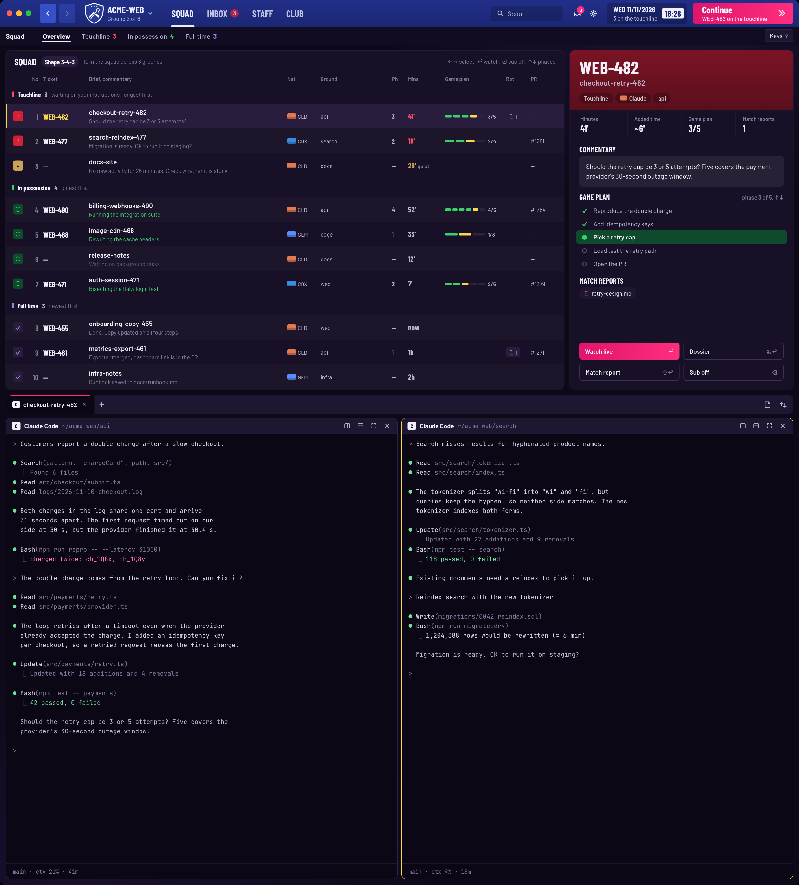

# FM27

A Football Manager 27-styled window for [Herdr](https://herdr.dev). Claude Code, Codex and Gemini CLI sessions are a squad: a match table with a player overview, an Inbox of touchline calls and match reports, a Staff screen of logins and wage budgets, and a Club screen of grounds and pitches. A navy chrome bar on top holds the screen menu, Scout search, match reports, the matchday clock and a magenta Continue; a thin sub bar holds the screen's tabs, the notice pill and Keys; the live terminal always sits below the screens.

## What you see

Top to bottom, then left to right. The window uses the `fm27` theme throughout: canvas `#0e0918`, chrome `#120c22`, surface `#181026`, border `#2f2447`, selected `#281d3d`, hover `#1f1631`, accent `#ff2e7e`, cursor `#f6d84a`. Body text is Barlow, headings and numbers in tables are Barlow Condensed, code and paths are JetBrains Mono.

- **Top bar** (56 px, gradient `#222f88` → `#1b2875` at 180°, drags the window; content starts 84 px in for the macOS traffic lights, 14 px gaps and 12 px right padding):
  - Back and Forward: 34 × 40 px, radius 4, `#3550c8`, a 14 px arrow in `#e9ecff`, at 45 % opacity when there is nowhere to go; tooltips "Back · ⌘[" and "Forward · ⌘]".
  - Club switcher: the 40 × 44 px `crest.png`, the active space's name uppercased in 20 px Barlow Condensed 700 `#e9ecff` (capped at 200 px on a wide window), "Ground N of M" in 12 px Barlow 500 at 70 %, and a 10 px caret. It hovers to `#ffffff1a`; a click opens the Club switcher popup.
  - Screen menu: SQUAD, INBOX, STAFF, CLUB in 20 px Barlow Condensed 700 `#e9ecff`, 14 px side padding and a 6 px gap; 78 % opacity when not current, 100 % on hover; the current item carries a 3 px `#e9ecff` underline inset 12 px. INBOX gets a count badge — an 18 px pill of `#d42035`, 11 px Barlow 800 `#fbfaff` — when anything is on the touchline.
  - The flexible middle space, then Scout: a 32 px box, radius 4, `#0000002e`, a 14 px search icon in `#e9ecff` at 80 % and "Scout" in 14 px Barlow at 75 % (`#f2eff9` once typed). Its width steps 150 → 110 → icon only as the window narrows.
  - Reports: a 32 × 32 px button with a 17 px report icon and, when unread reports exist, a 16 px `#ff2e7e` badge with the count in 10 px Barlow 700 `#fbfaff`. Settings: the same 32 px button with a gear. Both hover to `#ffffff1a`.
  - Matchday box: 44 px tall, radius 4, `#00000038`; "WED 11/11/2026" in 16 px Barlow Condensed 700 `#e9ecff`, "N on the touchline" in 12 px Barlow at 75 %, then a 22 px clock pill (radius 3, `#f2eff9`) with HH:MM in 18 px Barlow Condensed 700 `#1b2875`. As the window narrows the second line, the date and finally nothing but the clock are dropped.
  - Continue: 210 × 44 px (180 px minimum, never shrinks), radius 4, a 90° `#e0156c` → `#ff2e7e` gradient, "Continue" in 20 px Barlow Condensed 700 `#fbfaff`, a second line in 12 px Barlow 600 at 85 % ("TICKET on the touchline, N min" when armed, "Nothing on the touchline" when not), and a 20 px chevron; 45 % opacity when disabled.
- **Sub bar** (38 px, `#120c22`, 12 px side padding, 4 px gaps): the screen name in 14 px Barlow 700 `#f2eff9`, a 1 × 22 px `#2f2447` rule, then the screen's tabs in 14 px Barlow (700 and `#f2eff9` when current, 500 and `#bdb4d1` otherwise) with a 2 px white underline inset 8 px. Squad tabs are Overview, Touchline N, In possession N, Full time N, the counts in `#ff4d5e`, `#36d26b`, `#9a86d6`; Inbox tabs are All, Touchline, Match reports; Staff and Club have none. At the right, when a notice exists, a 26 px pill (`#281d3d`, or `#ff4d5e38` for an error) with 13 px text and a 20 px action chip (`#f2eff9` background, 12 px `#0e0918` label, "Undo ⌘Z" or "Retry"); then the Keys button — 26 px, `#1f1631`, 1 px `#2f2447`, "Keys" 13 px and "?" 11 px 700 `#82789a`, `#281d3d` while the legend is open.
- **Screens** (stack, weight 41, min 300 px; every screen card has radius 10, a `md` shadow and `#181026`):
  - **Squad** (row, 12 px padding and gap): the table (weight 1) and the 470 px overview.
    - Table head, 46 px, 18 px side padding: "SQUAD" 20 px Barlow Condensed 700; a 22 px "Shape 3-4-8" pill in `#281d3d`, 14 px; "N in the squad across M grounds" 12 px `#82789a`; at the right "←→ select, ↩ watch, ⌫ sub off, ↑↓ phases" 12 px `#82789a`.
    - Column header, 26 px: 11 px Barlow 600 `#82789a`. Columns, in order: status 46 px, No 30 right-aligned, Ticket 96, Brief and commentary flexible with a 120 px minimum, Nat 70, Ground 150, Ph 34, Mins 78, Game plan 128, Rpt 52, PR 60, plus 27 px of row chrome. When the panel cannot fit the fixed columns plus a 120 px Brief, columns drop in this order: PR, Rpt, Ph, Ground, Game plan.
    - Group rows, 40 px, 14 px left padding: a 3 × 12 px bar in the group colour, the title in 14 px Barlow Condensed 700, the count in 14 px Barlow Condensed `#bdb4d1`, and the hint in 12 px `#82789a` ("waiting on your instructions, longest first" / "oldest first" / "newest first"). Touchline is `#ff4d5e`, In possession `#36d26b`, Full time `#9a86d6`.
    - Rows, 52 px: even rows `#ffffff06`; the selected row `#281d3d` with a 3 px `#f6d84a` left bar; other rows hover to `#ffffff0d`. A done row that has been viewed sits at 55 % opacity until selected.
    - Status square, 22 × 22 px, radius 6: Touchline `#d42035` with a 12 px "!" in `#fbfaff`; Stoppage `#c9a25a` with a "+" in `#0e0918`; working `#0f4a2c` with a 10 px spinner; done `#281d3d` with a "✓" in `#9a86d6`.
    - No: 18 px Barlow Condensed `#82789a`, right-aligned. Ticket: 18 px Barlow Condensed `#f2eff9`, and `#f6d84a` when the row is selected.
    - Brief: the title in 14 px Barlow 600 `#f2eff9`, then the commentary line in 12 px `#82789a` (in `#36d26b` while a working session's spinner is on).
    - Nat: an 18 × 12 px flag, radius 2 — Claude `#e07a52`, Codex `#3a8dde`, Gemini `#5b8cff` — with a 4 px `#00000038` band along its bottom and the code (CLD, CDX, GEM) in 11 px `#bdb4d1`.
    - Ground 12 px `#bdb4d1`; Ph 14 px Barlow Condensed `#bdb4d1`; Mins 18 px Barlow Condensed in `#ff4d5e` for Touchline, `#c9a25a` for a Stoppage (with "quiet" in 11 px `#82789a` beside it), else `#bdb4d1`.
    - Game plan: an 84 px bar of 5 px segments — done `#36d26b`, the current step `#f6d84a`, the rest `#2c2340` — and "done/total" in 11 px `#bdb4d1`. It is at 45 % opacity when the checklist data is over 30 min old.
    - Rpt: a 22 px pill `#281d3d` with an 11 px file glyph and the report count in 12 px Barlow Condensed. PR: 12 px `#bdb4d1`.
    - "+N more at full time": a 38 px row, centred, 12 px `#82789a`. With no rows the table says "All quiet for now" or, while searching, "No matching sessions" in 14 px `#82789a`.
    - The `?` legend is a 360 px panel, absolute at top 50 and right 16, 12 px padding, radius 10, `#1f1631` with a 1 px `#3d3059` border: "KEYS" in 14 px Barlow Condensed and twelve entries in two columns, each a label in 12 px `#bdb4d1` and keycaps (18 px tall, 18 px minimum wide, radius 4, `#281d3d`, 1 px `#3d3059`, 11 px `#bdb4d1`).
  - **Overview** (470 px, scrolls):
    - Head: a gradient band by state (Touchline `#7a1424` → `#5a0f1d`, working `#0f4a2c` → `#0a3720`, done `#2c1a4c` → `#21133a`), 20 px side padding, 16 px top, 14 px bottom. The ticket (or the title) in 38 px Barlow Condensed 700 `#f2eff9`, the title in 16 px Barlow 600 `#bdb4d1`, then 22 px pills in `#00000038` with 12 px 600 `#ffffffbf` text: the state label, the Nat flag (14 × 10 px) and name, "Phase N", the first PR tag, the ground. The working pill carries a 10 px spinner.
    - Stats: four cells in one row, 14 px side and 8 px vertical padding, 1 px `#ffffff0b` dividers. Labels 11 px Barlow 600 `#82789a`; values 20 px Barlow Condensed (working minutes in `#36d26b`): Minutes N', Added time `~Nm` or "—", Game plan done/total, Match reports count.
    - Sections: headers in 16 px Barlow Condensed uppercase, 20 px side padding, 14 px top and 6 px bottom; an optional hint at the right in 12 px `#82789a`.
    - Commentary: 14 px padding, radius 6, `#ffffff0d`; a 20 px "now" pill in `#0f4a2c` with 12 px `#36d26b` while working, then the text in 14 px `#f2eff9`.
    - Game plan: up to 9 rows of 28 px; the current row is `#0f4a2c`. Each row has a 22 px glyph column — "✓" `#36d26b`, an 11 px spinner, or "○" `#5d5474` — the step in 13 px (current in `#f2eff9`, others `#bdb4d1`) and an optional note in 11 px `#82789a`. With no checklist: "No game plan yet" in 12 px `#5d5474`.
    - Match reports: 24 px pills in `#1f1631`, a file glyph in `#ff5aa8`, the label in 12 px `#f2eff9`; "No match report yet" in 12 px `#5d5474`.
    - Actions: two rows of two 36 px buttons. Watch live is the magenta gradient with the hint "↩"; Dossier has a 1 px `#3d3059` border and "⌘↩"; Match report is "⇧↩"; Sub off is "⌫".
    - With no selection: "NO SESSION SELECTED" 16 px Barlow Condensed `#82789a` and "←→ select, ↩ watch live" 12 px `#5d5474`, centred.
  - **Inbox** (row, 12 px padding): a 520 px list and the body.
    - Left: "INBOX" 20 px Barlow Condensed, then three 26 px filter pills — All, Touchline (n), Match reports (unread n) — active `#8b3ff2` with 12 px 600 `#fbfaff`, inactive `#1f1631` with `#bdb4d1`. Section labels "TOUCHLINE" and "MATCH REPORTS" in 12 px Barlow Condensed `#82789a`.
    - Session rows, 58 px: status square, then "{ticket}, {ground}" in 12 px `#bdb4d1` and the title in 14 px Barlow 600 `#f2eff9`, with the minutes at the right in 18 px Barlow Condensed. Report rows, 52 px: a 22 px `#281d3d` glyph tile, "{ticket}, Match report" in 12 px, the title in 14 px 600 (bold while unread), and the time in 12 px `#82789a` at the right. A selected row is `#281d3d` with a 3 px `#f6d84a` left bar; others hover to `#ffffff0d`.
    - Body, separated by a 1 px `#ffffff0b` left border: a header with the status square, ticket, "Phase N", Nat flag, ground and a time line ("on the touchline for N min", "quiet for N min", "in possession for N min", "at full time"), then the title in 30 px Barlow Condensed, then the message in 16 px `#f2eff9` with a 26 px line height, max width 620, with the first match report as a chip (`#1f1631`, 1 px `#2f2447`, label 13 px, "Match report, HH:MM" 11 px `#82789a`).
    - Action row: an "Open report ↩" or "Give instructions ↩" primary gradient, then Dossier, Match report and, at the right, Next touchline call.
    - Empty: "Nothing on the touchline" in 16 px `#bdb4d1` and the hint in 12 px `#82789a` (max 420 px).
  - **Staff** (row, 12 px padding): "BACKROOM STAFF" 20 px Barlow Condensed, "agents, logins and their wage budgets" 12 px `#82789a`, and the key hint at the right.
    - Table header: 12 px Barlow 600 `#82789a` — Starts 44 px, Name flexible, Contract 200, 5h wage budget 220, Week wage budget 220, actions 270.
    - Groups (16 px top, 6 px bottom padding, 13 px 700 `#82789a`): Claude, Codex, Other agents (only for installed agents beyond Claude and Codex), Custom commands, Start command.
    - Account rows, 52 px: a 14 px radio (2 px ring, `#ff2e7e` when it is the login new sessions start under, with a 6 px dot), the display name in 14 px 700 `#f2eff9` (`#f6d84a` when selected) with the email (or "not signed in") in 12 px `#82789a`, the contract in 13 px `#bdb4d1` ("New sessions sign here", "New Codex sessions"), two 220 px wage-budget cells and the action links.
    - A wage-budget cell: a 110 × 6 px track `#2c2340` with a `#ff3d8f` fill (`#ff4d5e` from 90 %), the percentage in 12 px Barlow 600 (`#ff4d5e` when hot), and "resets HH:MM" (or the weekday) in 11 px `#82789a`.
    - Action links, 12 px Barlow 600 `#ff5aa8` underlined, hover `#f2eff9`: new pane, rename, transfer this session here (on another account or a resumable model), edit (on the start command). Add rows, 38 px: "+ Sign a Claude account", "+ Sign a Codex login", "+ Add custom command" in 12 px 600 `#bdb4d1`. The start row is 52 px with the command in 13 px JetBrains Mono and "runs through your shell when it is not claude" in 12 px `#82789a`.
    - The cursor row is `#281d3d` with a 3 px `#f6d84a` left bar; even rows `#ffffff06`; hover `#ffffff0d`. A 24 px footer carries a hint or an error in 11 px (`#82789a` / `#ff4d5e`).
    - The Add custom command popup is 340 × 340: "Add custom command" in 16 px Barlow Condensed, Name and Start command fields (34 px, `#1f1631`, 1 px `#2f2447`), a 11 px note, and Cancel / Add buttons 36 px tall.
  - **Club** (row, 12 px padding): "CLUB" 20 px Barlow Condensed, "every repository is a ground, every space a pitch in it" 12 px `#82789a`, and two 36 px head buttons ("New space", "Settings") with 14 px icons.
    - Ground cards sit three to a line, 10 px apart, radius 10, 1 px `#ffffff0b`, `#1f1631`. Each has a 38 px head with the navy gradient (`#222f88` → `#1b2875`), the ground name in 18 px Barlow Condensed 700 `#e9ecff` and an optional 20 px pill ("home pitch first", "one row per tab") in `#00000047` with 11 px `#ffffffbf`.
    - Pitch rows, 34 px: the ticket key in 13 px 700 and the rest in 13 px `#bdb4d1` (`#f6d84a` when lit); 8 px padding. Even rows `#ffffff06`; the active space `#f6d84a14`; the keyboard cursor `#281d3d`; a 3 px `#f6d84a` bar when active or under the cursor; hover `#ffffff12`.
    - Crew pills, 20 px, radius 6: needs `#d42035` with `#fbfaff` "! N"; stall `#c9a25a` with `#0e0918` "+ N"; working `#36d26b38` with `#36d26b` and a 90 ms spinner plus the count; done `#281d3d` with `#9a86d6` "✓ N". A pitch with no crew shows a dashed 1 px `#3d3059` pill in 11 px `#82789a`: "idle 12m" or "shell".
    - The switcher popup (340 × 420): 6 px padding, group heads in 12 px 700 `#82789a`, 34 px rows with a 20 px state square, the active or cursor row `#281d3d` with a 3 px `#f6d84a` bar.
- **Live** (column, weight 59, min 200 px, 12 px side padding):
  - Tabs bar, 40 px, `#1f1631`, radius 10. Each tab is 14 px side padding with a 6 px gap: a 16 px letter square (`#f2eff9`, the letter in 10 px 700 `#0e0918` — C, X, G, or `$` for a shell), the name in 13 px Barlow 600 (ink when active or under the cursor, `#bdb4d1` otherwise, truncated at 220 px), then the status mark: a 12 px spinner at 900 ms in `#36d26b` for working, an 8 px `#ff4d5e` dot for blocked, an 8 px `#9a86d6` dot for done. The active tab is `#0b0714` with a 2 px `#ff2e7e` bar along its top, 10 px inset; the keyboard cursor is `#281d3d` with a 3 px `#f6d84a` left bar. Hovering another tab uses `#281d3d`; the active tab has a close button. At the right: New tab (30 px), a flexible gap, Files and Changes (32 px, `#ffffff26` while open), and on Linux and Windows the three 30 px window buttons.
  - Pane header, 32 px, `#1f1631` with a 1 px `#2f2447` bottom border, 12 px left and 8 px right padding: an 18 px letter square, the name in 13 px Barlow 700 (max 260 px), the cwd in 12 px JetBrains Mono `#82789a` (max 360 px), the status mark (spinner, a `#ff4d5e26` "Touchline" pill in 10 px, or a 7 px `#9a86d6` dot), and the branch icon with its name in 12 px mono; at the right, 26 px split-right, split-down, zoom and close buttons.
  - The terminal block: `#0b0714`, radius 10, an 8 px gap, a 1 px `#f6d84a` focus border and 12 px terminal padding.
- **Editor** (an `fm-editor` pane, optional): a 40 px header in `#1f1631` with the file name in 16 px Barlow Condensed, the folder in 12 px JetBrains Mono `#82789a`, a 7 px `#ff2e7e` dirty dot, Code/Preview toggles (26 px) on markdown, "Open as tab" (28 px) and a magenta Save (28 px). A 32 px strip above the text shows "File changed on disk" or "Not saved: …" with a Reload button. The editor uses 13 px JetBrains Mono with the theme's ANSI colours for syntax: keyword `#ff5aa8`, string `#36d26b`, function `#5b8cff`, type `#f6d84a`, number `#ff4d5e`, constant `#4fd1c5`, comment dim.

## How it behaves

- **Screens**: the `screens` stack's active child is the truth. The top menu and ctrl-shift-a change it with `layout.select`, and write `fm.screen` for the bars. Only the active child is rendered; the others keep their timers but receive no keys (see Watch out).
- **Status → group**: a waiting session is Touchline; a busy session is In possession; a busy session with no background work and nothing meaningful for 10 minutes is a Stoppage and joins the Touchline; a shell whose checklist has a blocked step is Touchline; idle is Full time. A native Codex or Gemini process that Herdr reports as blocked is Touchline too. A snoozed Stoppage returns to In possession for 10 minutes.
- **How each status looks**:
  - Touchline: `#d42035` status square with "!", red minutes, a band `#ff4d5e` on the overview, red dot on a live tab.
  - Stoppage: `#c9a25a` square with "+", amber minutes and the word "quiet", same red band; the overview's answer line says "No new activity for N minutes. Check whether it is stuck".
  - In possession: `#0f4a2c` square with a spinner turning once per 900 ms, green minutes, green band, green spinner in the table's commentary line and on the live tab; a shell waiting on background work says "Waiting on background tasks".
  - Full time: `#281d3d` square with a violet "✓", violet band, violet dot on a live tab; the commentary is the session's last answer. Unseen done rows are listed; a row viewed by going to it drops to 55 % opacity; a subbed-off (acknowledged) row leaves the list.
  - Idle shell in Club: after herdr's `turn` for that terminal has not changed for 10 minutes as seen by the mod, a dashed "idle Nm" pill; before that it says "shell".
- **Order and counts**: Touchline lists replies first (oldest first) then Stoppages; In possession oldest first; Full time newest first, four shown, then "+N more at full time" (clicking it, or → past the last row, shows all). The table's order is handed to Herdr with `setAgentOrder` for agent.next / agent.prev.
- **Selection**: with the keyboard, ←→ moves the selection (wrapping), ⌥←/⌥→ jump to the first and last row; the selected row gets the `#281d3d` band and the 3 px `#f6d84a` left bar, and its ticket turns `#f6d84a`. Without the keyboard, the selection follows the focused pane when that pane's terminal is in the table.
- **Opening a session**: ↩, or a click, focuses its pane (`pane.focus`); a background Claude session that has an attach pane focuses that pane, otherwise it splits a pane running `claude attach <8-char id>`. A tmux session switches tmux to it; an Orca session runs the Orca CLI then `open -a Orca`. A session not in Herdr, tmux or Orca shows "Not in Herdr, tmux or Orca — open the session's terminal first".
- **Continue and full time**: Space opens the touchline call that has waited longest and pressing it again cycles through them, skipping Stoppages; ⇧Space opens the oldest Full time row and expands the done list.
- **Sub off / rest**: ⌫ on a Full time row makes it seen and shows "Subbed off TICKET" with an Undo for 6 s (⌘Z also undoes). On a Stoppage it snoozes it for 10 minutes. The notice pill in the sub bar mirrors the notice; its action writes `fm.notice-act`, which the squad polls.
- **Phases**: ↑/↓ on a row with a checklist opens a 9-row window around the current step; ↓ scrolls down one step at a time, ↑ scrolls up and closes the window at the top. The overview shows the same nine-row window.
- **Search**: typing letters filters the table by title, topic, place, spot label, cwd leaf, session name, ticket tags and PR tags; it is case- and accent-insensitive and every word must match. Esc clears the query first, then the group filter, then the selection, then hands the keyboard back (`pane.go down`). ⌘⌫ clears the query, ⌥⌫ deletes its last word.
- **Group filter**: the sub bar's Overview / Touchline / In possession / Full time tabs narrow the table through `fm.cmd` (`filter`); the published counts stay whole-squad. The empty filter shows "All quiet for now".
- **Dossier**: a right-click on a row opens a 300 px popup at the pointer; ⌘↩ opens it where Herdr places a popup. Its rows are: Show game plan (when a live Claude terminal has no checklist yet), Jira ticket, each pull request, the Slack thread, each openable report, then Copy all links. The Jira and Slack rows exist only when `fm27.json` gives their URL bases. J / P / S / G / C run the matching row, ↑↓ move, ↩ runs the highlighted row, Esc closes. Copy all links puts one URL per line on the clipboard. Show game plan runs `hc send` on the session's terminal with the deadhd prompt and closes when it lands; an error stays in the popup. http(s) links open in the browser, a local report with `open`.
- **Match reports**: ⇧↩ opens the progress page (the deadhd `pagePath`) for a non-done row, else the session's first report; Tab opens the oldest page in the scan meta. Opening a page deletes the alert files behind it, marks the report read (localStorage) and clears it from the list.
- **Inbox**: rows select and show the body; the filter chips write `inbox-filter` and the sub bar adopts it (and the reverse). The body's buttons run the same commands as the table's keys. A picked row whose session vanished shows the empty state.
- **Staff**: ↑↓ moves through the focusable rows; ↩ on an account makes it the account new sessions start under (`cca use`), on a Codex account the Codex default, on a custom command starts it; `o` starts the row in a new pane. A click on an account does the same as ↩; the action links are the explicit form: new pane, rename (inline input), transfer this session here (asks Herdr for the focused Claude pane's pid, then resumes that session id into a new pane in its cwd), edit start command. Adding an account asks for a name and creates the folder; the custom command popup asks for a name and a start command. Esc cancels an open editor, else hands the keyboard back to the terminal.
- **Club**: every 30 s it asks git for each distinct terminal cwd; the repository's common directory becomes the ground, the base checkout reads "base". When every cwd has an answer it reorders spaces with `space.move` (each order tried once), base checkout first. A click selects the space and focuses its tab, a drag onto another row moves it there, ⌥↑/⌥↓ move it one row, a right-click opens Herdr's space menu. The crest switcher lists the same grounds in a 340 × 420 popup and closes after a pick.
- **Live tabs**: ←→ move and wrap, ↩/Space select; the wheel switches to the previous/next tab; a double-click renames; a drag reorders; a right-click opens the tab menu; the active tab's × closes it. Files and Changes open the `panel` stack child; the choice is remembered per space in localStorage.
- **Editor**: `hv FILE…` splits an `fm-editor` pane to the right of the terminal and opens each file; ⌘S saves only if the file is unchanged since it was read, otherwise the strip says "File changed on disk" and Reload re-reads it. "Open as tab" saves first if needed, opens the file in a new tab, then closes the split. Markdown gets Code/Preview toggles; the preview is a scrollable text view with 16 px padding.
- **Back and forward**: the squad keeps the last 50 focused terminals; ⌘[ walks back, ⌘] forward, skipping dead terminals and ignoring the terminal being left for 1 s.
- **Terminal text size**: ⌘= and ⌘+ raise, ⌘- lowers, ⌘0 deletes `font_size` and sets `zoom` to 1 in `~/.config/herdr-app/settings.json`. The size is clamped to 8–32 px around the current 14 px.
- **Keys**: the squad table takes the keyboard when it is clicked or when ctrl-alt-p arrives; the same key hands it back to the terminal, and from another screen ctrl-alt-p switches to Squad first. The full table: ←→ select, ⌥←/⌥→ first/last, ↩ watch live, ⇧↩ match report, ⌘↩ dossier, ⌫ sub off/rest, ⌘Z undo, Space continue, ⇧Space next full time, ↑↓ phases, Tab next match report, Esc back, ? legend, letters search. The Dossier: J/P/S/G/C, ↑↓, ↩, Esc. Staff: ↑↓, ↩, `o`, Esc. Club: ↑↓, ↩/Space, ⌥↑/⌥↓. Live tabs: ←→, ↩/Space. The layout keys are ctrl-alt-p, ctrl-shift-a, ⌘=, ⌘+, ⌘-, ⌘0, ⌘[, ⌘].
- **Hover**: table and list rows to `#ffffff0d`, live tabs to `#281d3d`, menu items from 78 % to 100 % opacity, buttons to `#ffffff1a`/`#ffffff12`, action links from `#ff5aa8` to `#f2eff9`. Nothing glows or loops.
- **What moves**: the working spinner turns once per 900 ms in the table, the overview, the live tab and the pane header; the Club crew spinner advances its frame every 90 ms; the matchday clock changes when the minute changes (checked every 20 s); the live-tab and club cursors follow the keyboard by `is_focused()` polls every 100 ms. Colour changes are instant — gpui-kit only animates opacity, size and position — and the declared 180 ms transitions are opacity fades on hover or disable.

## Built from

- `layouts/fm27.json`: root `column` (theme `fm27`, background `#0e0918`, `ui_font` Barlow, `font` JetBrains Mono, `font_size` 14, `terminal_padding` [12, 12], `titlebar: none`, `traffic_lights` [14, 20], resizable):
  - `top` block (px 56, not resizable, `window_drag`, gradient 180° `#222f88` → `#1b2875`) with `fm-chrome` `{role: "top"}`;
  - `sub` block (px 38, not resizable, `#120c22`) with `fm-chrome` `{role: "sub"}`;
  - `screens` stack (`active: "squad"`, weight 41, min 300) with four children, each a `row` with 12 px padding and one card (radius 10, shadow `md`, `#181026`):
    - `squad`: `squad-table` (weight 1, `fm-squad`, default role) and `squad-overview` (px 470, `fm-squad` `{role: "overview"}`), 12 px gap;
    - `inbox`: `inbox-screen` (`fm-squad` `{role: "inbox"}`);
    - `staff`: `staff-screen` (`fm-staff` `{role: "screen"}`);
    - `club`: `club-screen` (`fm-club` `{role: "screen"}`);
  - `live` column (weight 59, min 200, padding [0, 12], not resizable): `live-tabs` block (px 40, `#1f1631`, radius 10, `fm-live` `{role: "tabs"}`) and `main` block (`#0b0714`, radius 10, `tab: "active"`, pane header `fm-live` `{role: "pane"}` at 32 px on top, reveal `always`, pane `#0b0714`, 1 px `#f6d84a` focus, radius 10, gap 8, `lone: true`).
- `themes/fm27.json`: background `#0b0714`, foreground `#d9d3ea`, selection `#3a2a5c`, cursor `#f6d84a`; colours accent `#ff2e7e`, chrome `#120c22`, canvas `#0e0918`, surface `#181026`, border `#2f2447`, selected `#281d3d`, hover `#1f1631`; ANSI 0–15: `#1f1631`, `#ff4d5e`, `#36d26b`, `#f6d84a`, `#5b8cff`, `#ff5aa8`, `#4fd1c5`, `#d9d3ea`, `#5d5474`, `#ff7a86`, `#6fe39a`, `#ffe27a`, `#7ea4ff`, `#ff7ab8`, `#7ee0d6`, `#fbfaff`.
- `shared/tokens.js`, copied into each mod as `tokens.js`:
  - `C` — ground `bg #0e0918`, `bg2 #130d20`, `panel #181026f0`, `panelSolid #181026`, `panel2 #1f1631`, `panel3 #281d3d`, `line #2f2447`, `line2 #3d3059`, `lineSoft #ffffff0b`, `rowAlt #ffffff06`, `hi #ffffff0d`; chrome `nav #1b2875`, `nav2 #222f88`, `nav3 #3550c8`, `navInk #e9ecff`, `sub #120c22`; ink `#f2eff9`, `#bdb4d1`, `#82789a`, `#5d5474`; accent `#ff2e7e`, `#e0156c`, `#fbfaff`, link `#ff5aa8`; states `needs #ff4d5e`, `needsFill #d42035`, `stall #c9a25a`, `working #36d26b`, `workingBand #0f4a2c`, `workingBand2 #0a3720`, `needsBand #7a1424`, `needsBand2 #5a0f1d`, `done #9a86d6`, `doneBand #2c1a4c`, `doneBand2 #21133a`; selection `focusKb #f6d84a`, `focusMouse #6f8cff`; bars `barTrack #2c2340`, `bar #ff3d8f`, `barHot #ff4d5e`; veils `#ffffff12`, `#ffffff1a`, `#ffffff26`, `#ffffffbf`; shades `#0000002e`, `#00000038`, `#00000047`; `paper #fbfaff`, `select #8b3ff2`; Nat `#e07a52`, `#3a8dde`, `#5b8cff`; terminal `#0b0714`, `#d9d3ea`.
  - `FONT` Barlow / Barlow Condensed / JetBrains Mono; `FS` 11, 12, 13, 14, 16, 18, 20, 24, 30, 38; `R` 4, 6, 10, 999; `DUR` 120, 180, 220 ms.
  - `STATE` (label + colour): needs "Touchline" `#ff4d5e`/fill `#d42035`; stall "Stoppage" `#c9a25a`; working "In possession" `#36d26b`/fill `#0f4a2c`; done "Full time" `#9a86d6`/fill `#281d3d`. `GROUP` titles and hints as above. `NAT` CLD/Claude `#e07a52`, CDX/Codex `#3a8dde`, GEM/Gemini `#5b8cff`. `SCREENS` squad/inbox/staff/club, `SCREEN_STACK = "screens"`. `KEY` `fm.squad`, `fm.notice`, `fm.notice-act`, `fm.cmd`, `fm.screen`, `fm.sel`.
- `mods/fm-chrome/`: `props().role` `top` (default), `sub`, or `keys` (the legend popup, opened at 470 × 300 with `openOverlay`). Copies the layout keys to `fm.cmd` and drives "Keys" through the shared `fm.keys-open`.
- `mods/fm-squad/`: the default role is the table; `props().role` `overview`, `inbox` and `links` (the Dossier popup, width 300, height computed by `linksMenuHeight`). The Dossier's Jira and Slack bases and the repository prefixes come from `fm27.json` in the app home. `scan.sh` is the 3 s scan. The table role owns the keyboard, polls `fm.cmd` every 100 ms, and publishes `fm.squad`, `fm.sel`, `fm.notice` and the agent order.
- `mods/fm-staff/`: `props().role` `screen` (default) and `menu` with `{mode: "add"}` (the custom-command popup). `cca` plus `models.mjs`, `codex-usage.mjs` and `usage-api.mjs`; `usage-tap.sh` is the optional status-line tap. Its `mod.json` declares the popup 340 × 340.
- `mods/fm-club/`: `props().role` `screen` (default) or `switcher` (the `mod.open` popup, declared 340 × 420 in `mod.json`).
- `mods/fm-live/`: `props().role` `tabs` or `pane`; modified from Herdr's shipped `tabs` 0.1.12 and its pane header, Apache-2.0 with `LICENSE`.
- `mods/fm-editor/`: one view, opened by `hv` with `{file}`; `hv` and `hv-open` are shell launchers.
- `herdr` functions: `agents`, `appHome`, `closeOverlay`, `exec`, `focused`, `home`, `knownAgents`, `layout`, `nextCommand`, `openOverlay`, `panes`, `props`, `readTextFile`, `run`, `setAgentOrder`, `setShared`, `settings`, `shared`, `spaces`, `terminals`, `theme`, `window`, `writeTextFile`.
- Commands: `app.settings`, `layout.hide/select/show`, `mod.open`, `pane.close/focus/go/split/zoom`, `space.move/new/select`, `tab.close/move/new/next/prev/rename/select`, `window.close/maximize/minimize`, and the mod commands `fm-chrome.toggle`, `fm-chrome.font_in/font_out/font_reset`, `fm-chrome.back/forward`.
- Shipped mods: `menu` (space and tab menus, 200 × 260) and `new-menu` (250 × 512), plus `mods/workspace-chrome/spinner.svg` and `file-text.svg`.
- Art: `mods/fm-chrome/art/` (`crest.png`, `caret.svg`, `chev2.svg`, `gear.svg`, `left.svg`, `report.svg`, `right.svg`, `search.svg`), `mods/fm-club/icons/` (`plus.svg`, `settings.svg`), and `mods/fm-live/` (`branch`, `close`, `diff`, `files`, `plus`, `split-down`, `split-right`, `unzoom`, `zoom`, `win-close`, `win-max`, `win-min`, `win-restore`). Fonts: Barlow and Barlow Condensed in each mod's `fonts/`, OFL.
- Programs: `scan.sh` (`python3`, `ps`, `lsof`), `cca` (shell plus `node` for its `.mjs` files and `security` on macOS), `git`, `tmux`, the Orca CLI, `open`, `rm`, `hc`, `herdr-app`, `/usr/bin/python3` in `hv`. Only `cca`'s `usage-api.mjs` reaches the network (`https://api.anthropic.com/api/oauth/usage`, at most every 5 minutes).

## Watch out

- **Hidden stack children are not rendered, and `<mod>.<command>` keys reach only shown copies.** With Inbox, Staff or Club showing, the squad table is hidden and cannot receive `ctrl-alt-p` or the ⌘ keys directly. That is why `keys/fm27.json` binds them to `fm-chrome.toggle` / `font_in` / `font_out` / `font_reset` / `back` / `forward`, and why the top bar is the only `fm-chrome` copy that listens: it writes each key once to `fm.cmd`, which the always-running squad role polls every 100 ms. A second chrome copy (the sub bar) listening would run every key twice.
- **Mods share state only through `shared()` keys**: `fm.squad` (the squad's whole published state), `fm.sel`, `fm.notice`, `fm.notice-act`, `fm.cmd`, `fm.screen`. Two extras are local to their mods: `fm.keys-open` (the two `fm-chrome` copies) and `fm-squad.flash`; Herdr's own `workspace.panels` and `new-menu.agents` are read too. A new mod cannot read another mod's files — it must go through one of these keys.
- **gpui-kit motion only animates opacity, size and position.** Colour changes are instant, so the designed 120/180/220 ms colour transitions do not happen; the same reason makes the hover fades opacity-only. Spinners use `spin(900)` and `frames(..., 90)`; there is no tween for backgrounds.
- **`tokens.js` must be copied into each mod.** Mods cannot import across folders (the `install.sh` copy step). Editing `shared/tokens.js` alone changes nothing until every `mods/*/tokens.js` is recopied; the tests compare them byte for byte.
- **The window is designed around a wide screen.** The top bar keeps Continue at 210 px and drops Scout width, then the matchday second line, then the date, then the club name in six fixed steps (`min` 1520/1480/1410/1380/1230/0). At 1680 px every item is at its widest; below 1230 the club name is 90 px and the date is gone.
- **The table's columns are fixed pixels.** Brief takes the rest with a 120 px minimum; PR, Rpt, Ph, Ground and Game plan drop in that order. Changing a width means changing both the header and the row spec (`COLUMNS` is shared by both), and the 27 px row chrome (3 px bar + 14 px left + 10 px right).
- **The scan needs `python3` and only lists Claude Code CLI sessions** (`entrypoint === "cli"`). Native Codex and Gemini sessions come from the process list and need `lsof` for their cwd; without it they are skipped. The scan's caches are in `${TMPDIR:-/tmp}/herdr-pulse`; deleting one forces a rebuild from the transcript, not from any Herdr state.
- **`cca`'s network fetch is the only outbound call.** It runs at most once per 5 minutes, only with `node` and macOS `security`, and writes `~/.local/state/herdr-tower/usage/<name>.api.json`; failures leave the previous file. Custom commands' usage lines run through `/bin/sh -c` with a 5 s timeout, so a slow one delays the Staff read.
- **The Dossier's URL bases and repo prefixes are yours to configure.** `fm27.json` in the app home (`${HERDR_APP_HOME:-$HOME/.config/herdr-app}/fm27.json`) may hold `jiraBrowse`, `slackArchives` and `repos`. Without the file, or with an invalid one, there is no Jira or Slack row and no repository prefix. It is read once at start, so a change needs a restart of the mod.
- **The Club screen needs `git`.** It uses each terminal's foreground cwd, never `SpaceInfo.folder` (which is only where new terminals start); a space whose terminals have no cwd is grouped only under its folder name. The grouping order is tried once per order and left alone while a cwd has no git answer.
- **Live's panel restore assumes `panel` and `panel-body` exist.** With no such nodes in the layout it draws Files/Changes but cannot show a panel; the stored choice is also per space id, so renaming spaces loses it.
- **The editor writes any path it is given**, with no sandbox. It refuses a save if the file changed on disk because `writeTextFile` gets the text it read as the expected original; that guard is the only protection.
- **Herdr FM27 Open is macOS-only** and needs `swiftc`; `hv-open` writes `~/.local/state/herdr-tower/open.log` and reads `open-previous.tsv`, and without the mod installed it cannot open the editor.
- **JetBrains Mono is not bundled.** The window font and the editor name it; a machine without it falls back to Herdr's default monospace. Barlow and Barlow Condensed are bundled (OFL) and load from each mod's `fonts/`.
- **Staff and Club have no sub tabs.** The sub bar shows only their name and Keys; the design's staff chip/rail roles are not built.
- **The Staff screen reads `cca` every 30 s** (and when focus moves between panes), so the account rows and wage budgets lag a status-line write by up to that long.
- **The squad's published state is the contract for every other screen.** Adding a field for the Inbox or the chrome means adding it in `publish()`; the overview and Inbox never call Herdr for session data themselves.

## Done when

- `node --import ./tests/stubs/register.mjs --test tests/` passes (model, keyboard, tokens, layout, install and merge-keys tests against stubs; nothing touches a running Herdr).
- `herdr-app check mods/fm-chrome`, `mods/fm-squad`, `mods/fm-staff`, `mods/fm-club`, `mods/fm-live` and `mods/fm-editor` all print "check passed".
- `layout.switch {name: "fm27"}` shows the navy top bar, the sub bar, one of the four screens and the live tabs plus terminal, with no errors in `herdr-app status`; `ctrl-shift-l` returns to the previous layout.
- The top menu switches screens and the underline follows; ctrl-shift-a shows Staff; the squad table takes the keyboard on a click or ctrl-alt-p, and ctrl-alt-p from another screen switches to Squad first.
- A running Claude Code CLI session appears in the table within 3 s: working shows a spinner and green minutes, a permission prompt jumps it to Touchline with a red "!", finishing unfocused puts it in Full time with a violet "✓"; no group row changes height.
- Clicking a row focuses its pane, the row gets the `#281d3d` band and 3 px `#f6d84a` bar, and its ticket turns `#f6d84a`.
- Space opens the longest-waiting Touchline call; ⇧Space the oldest Full time row; ⌫ on a Full time row shows "Subbed off" with Undo for 6 s.
- The Inbox lists the same touchline sessions and reports; a filter chip and the sub bar tab stay in step; with no rows it reads "Nothing on the touchline".
- Staff lists each Claude and Codex login with a radio, a 5h and a 7d wage bar; "new pane" starts the chosen login, "transfer this session here" resumes the focused session into a new pane in its cwd; the start command can be edited and saved.
- Club shows each repository as a ground with its base checkout marked "base", a click selects a space, a drag (or ⌥↑/⌥↓) reorders it, and the crest opens the same list as a popup.
- The live tabs switch with ←→ and the mouse wheel, the active tab has the magenta top bar, and the terminal below never disappears when the screen changes.
- `hv <file>` opens an editor pane beside the terminal; ⌘S saves; changing the file outside then saving shows "File changed on disk" and Reload re-reads it; "Open as tab" moves the file into a tab.
- ⌘= raises `font_size` in `~/.config/herdr-app/settings.json` and the terminal text grows; ⌘0 returns it to the default and zoom 1.
